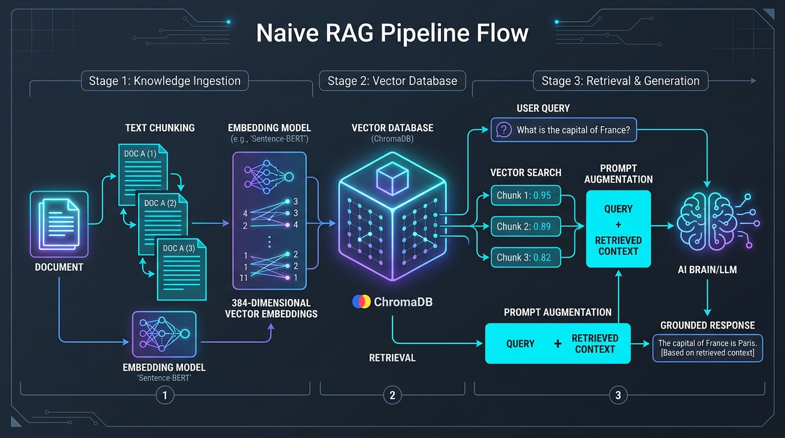
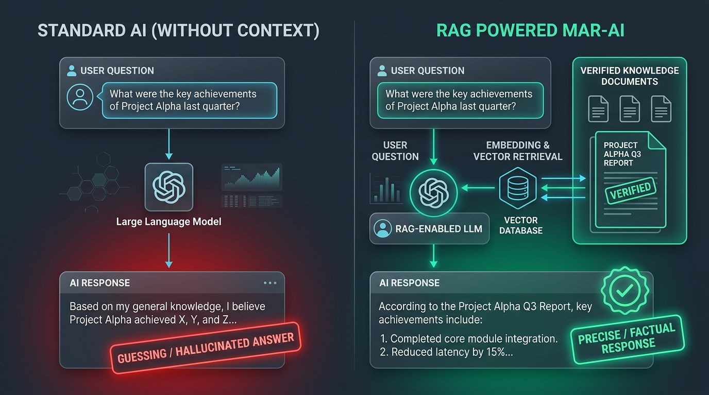
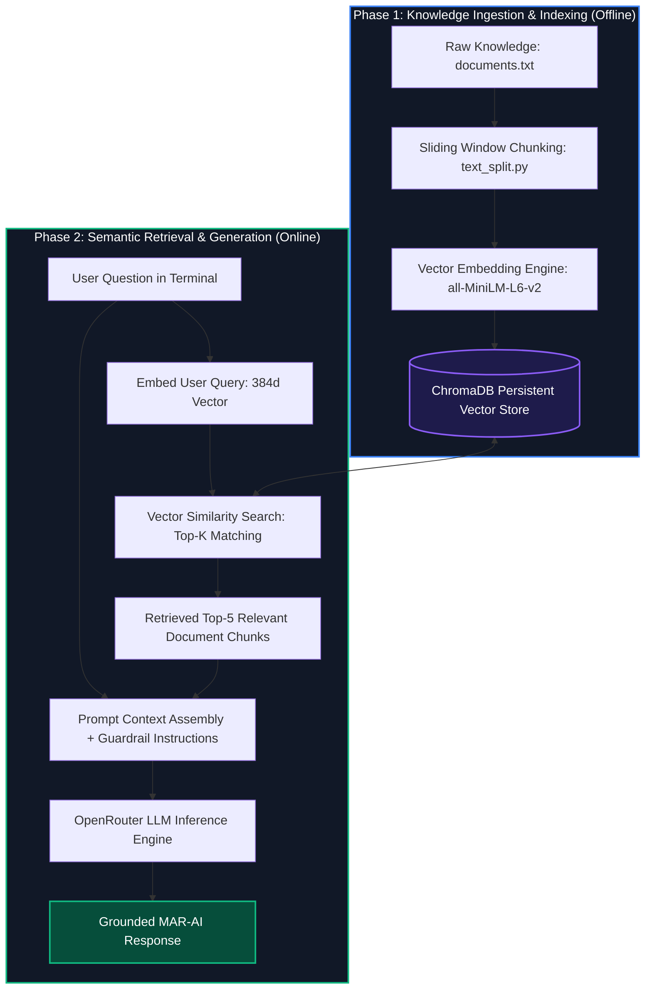

# MAR-AI: Naive Retrieval-Augmented Generation (RAG) Pipeline

[](https://www.python.org/)
[](https://www.trychroma.com/)
[](https://openrouter.ai/)
[-green.svg)](https://huggingface.co/sentence-transformers/all-MiniLM-L6-v2)
[](LICENSE)

An end-to-end, locally grounded **Naive Retrieval-Augmented Generation (RAG)** system built with Python, ChromaDB, and OpenRouter. This pipeline transforms unstructured personal and professional documentation into an interactive digital representative called **MAR-AI**, capable of answering real-time questions accurately without hallucinations.

---

## Visual Architecture Overview



---

## Table of Contents

1. [What is RAG? (Explained for Non-Programmers)](#what-is-rag-explained-for-non-programmers)
2. [Why Standard AI Fails vs. Why RAG Wins](#why-standard-ai-fails-vs-why-rag-wins)
3. [System Architecture and Workflow](#system-architecture-and-workflow)
4. [Engineering Deep Dive: The 6 Pipeline Stages](#engineering-deep-dive-the-6-pipeline-stages)
5. [Real-World Execution and Sample Output](#real-world-execution-and-sample-output)
6. [Repository Structure](#repository-structure)
7. [Installation and Quickstart](#installation-and-quickstart)
8. [Mathematical Foundations](#mathematical-foundations)
9. [Naive RAG Limitations and The Path to Advanced RAG](#naive-rag-limitations-and-the-path-to-advanced-rag)
10. [Frequently Asked Questions (FAQ)](#frequently-asked-questions-faq)
11. [Author and Acknowledgments](#author-and-acknowledgments)

---

## What is RAG? (Explained for Non-Programmers)

Imagine a student taking an exam:

* **Standard AI (Closed-Book Exam):** The student must rely solely on memory. If they do not remember a specific detail, or if the question is about private information they never studied, they may guess or fabricate a convincing lie. In AI terminology, this fabrication is called a **hallucination**.
* **RAG (Open-Book Exam):** Before writing any answer, the student walks over to a trusted reference bookshelf, opens the exact page that contains the verified facts, reads that section, and writes down the answer citing only the facts on that page.

**RAG** stands for **Retrieval-Augmented Generation**:

* **Retrieval:** Searching and fetching relevant sections of text from a verified private database based on the user's question.
* **Augmented:** Taking the retrieved facts and pasting them into the prompt given to the AI.
* **Generation:** Letting the Large Language Model (LLM) synthesize a polite, natural language response based exclusively on those retrieved facts.

---

## Why Standard AI Fails vs. Why RAG Wins

Standard commercial LLMs know general world history and coding patterns, but they do not know private documents, company wikis, or individual developer portfolios. 



| Capability | Standard LLM (Without RAG) | RAG Pipeline (MAR-AI) |
| :--- | :--- | :--- |
| **Private Knowledge** | Zero awareness of private files | Full awareness via local documents |
| **Factual Accuracy** | Prone to hallucinations and guesswork | Grounded strictly in retrieved context |
| **Knowledge Updates** | Requires costly model retraining | Instant updates (just edit `documents.txt`) |
| **Data Privacy** | Sensitive data sent during retraining | Data stays indexed in local vector storage |
| **Traceability** | Cannot easily trace where facts originated | Exact source chunks and distance scores visible |

---

## System Architecture and Workflow

The system operates across two core cycles: an offline **Knowledge Ingestion Phase** and an online **Interactive Query Phase**.



---

## Engineering Deep Dive: The 6 Pipeline Stages

### Stage 1: Document Ingestion and Chunking (`utils/text_split.py`)

Language models cannot efficiently digest entire book-length files at query time due to context window limits, cost, and attention dilution (the "needle in a haystack" problem). Therefore, the source document (`documents.txt`) must be divided into smaller passages called **chunks**.

In this implementation:
* **Chunk Size:** 800 characters per block.
* **Overlap:** 100 characters sliding window.

```
Original Text Stream:
[==================== Block 1 (800 chars) ====================]
                     [===== Overlap 100 =====]
                     [==================== Block 2 (800 chars) ====================]
```

**Why Overlap Matters:** If an important sentence is sliced directly down the middle between two chunks, the semantic meaning would be destroyed. Overlapping characters preserve cross-boundary context so that every fact remains coherent in at least one chunk.

---

### Stage 2: Dense Vector Embeddings (`utils/config.py`)

Computers cannot calculate mathematical similarities using raw English words. An **Embedding Model** translates words, sentences, and paragraphs into a dense list of numbers called a **vector**.

* **Model Used:** `all-MiniLM-L6-v2` via ChromaDB Default Embedding Function.
* **Dimensionality:** 384 dimensions.

```
Text: "MAR Miju specializes in Python, JavaScript, and Full-Stack Engineering."
Embedding: [-0.0421, 0.0814, -0.0155, 0.1290, ..., 0.0037]  (Length: 384 numbers)
```

In this 384-dimensional geometric space, sentences with similar meanings land close to one another, even if they use completely different vocabulary (for example, "developer" and "programmer").

---

### Stage 3: Persistent Vector Storage (`chroma_db/store`)

The generated embeddings and their corresponding text segments are indexed into **ChromaDB**, an open-source, AI-native vector database.

* **Collection Name:** `developer_knowledge`
* **Storage Mode:** Persistent client (`./chroma_db/store`), which writes data directly to disk. Once indexed, the documents remain preserved across restarts without re-computing embeddings on every launch.
* **Upsert Protocol:** Chunks are saved with explicit IDs (`chunk-0`, `chunk-1`, etc.) to prevent duplicate records.

---

### Stage 4: Similarity Search and Distance Scoring (`index.py`)

When the user enters a prompt in the terminal:

1. The user's question is passed to the embedding engine to produce a 384-dimensional query vector.
2. ChromaDB calculates the geometric distance between the query vector and every chunk stored in the database.
3. The closest $K=5$ chunks are returned alongside their distance scores:

```python
results = collection.query(
    query_embeddings=embedding_input,
    n_results=min(5, collection.count()),
    include=["documents", "distances"]
)
```

**Understanding Distance Scores:**
ChromaDB uses squared Euclidean (L2) distance by default.
* **Low Distance (e.g., < 1.2):** High semantic match; strong relevance.
* **High Distance (e.g., > 1.7):** Low semantic match; the chunks are distant concepts in vector space.

---

### Stage 5: Context Augmentation and Persona Prompting

The top-5 retrieved chunks are concatenated and injected into a structured system prompt. This prompt acts as the system guardrail:

```python
prompt = f"""
Answer the user's question using the provided context.

CONTEXT:
{context}

USER QUESTION:
{user_input}

INSTRUCTIONS:
- Answer using the provided context.
- Do not invent information.
- If the context does not contain the answer,
  say you don't have enough information.
- You are MAR-AI.
- Always act on behalf of MAR Miju so the user experiences MAR Miju answering directly.
"""
```

**Key Safety Guardrails:**
* **Grounded Answer Boundary:** "Do not invent information" prevents the LLM from filling in missing pieces with wild fabrications.
* **Polite Refusal Directive:** "If the context does not contain the answer, say you don't have enough information."
* **Persona Calibration:** The model maintains the professional persona of MAR Miju.

---

### Stage 6: Generation via OpenRouter

The augmented prompt is transmitted via the **OpenRouter API**, which provides unified access to cutting-edge open-source and commercial language models. The returned completion is streamed back to the user terminal.

---

## Real-World Execution and Sample Output

Below is an authentic trace from a live terminal session showing how MAR-AI handles both in-domain queries and out-of-boundary questions.

```bash
$ python index.py
chunk started.....................
chunking..........................
chunk completed!
Embedding started...
Embedding completed!

User: hello my name is tareq and what's you?
Embedding started...
Embedding completed!
distance: [1.521, 1.718, 1.763, 1.791, 1.805]

MAR-AI: Hello Tareq! I am MAR-AI, the AI assistant for MAR Miju. 
I'm here to help with any questions you might have about his work or skills. 
How can I assist you today?

User: what's your wife name?
Embedding started...
Embedding completed!
distance: [1.621, 1.786, 1.798, 1.891, 1.893]

MAR-AI: I don't have enough information provided in my knowledge base 
to share personal family details like my spouse's name. My professional 
focus and work history are detailed in my portfolio, but specific personal 
relationships aren't included in the context available to me.
```

### Analysis of the Behavior:
1. **Inquiry 1 (Identity & Skills):** Distance was lower (1.52). The context provided developer identity details, allowing MAR-AI to welcome the user warmly and establish its identity.
2. **Inquiry 2 (Out-of-Domain Personal Question):** Distance was higher (up to 1.89). No document chunks contained family data. Instead of hallucinating a fake name, the prompt instructions guided MAR-AI to refuse gracefully and steer back to professional topics.

---

## Repository Structure

```
RAG/
├── assets/
│   ├── rag_architecture.png       # High-resolution architectural diagram
│   └── rag_example_comparison.png # Comparison graphic between Plain AI and RAG
├── chroma_db/
│   └── store/                     # Persistent on-disk vector database directory
├── utils/
│   ├── __init__.py                # Module initialization
│   ├── config.py                  # ChromaDB client, collection init, embedding setup
│   └── text_split.py              # Text chunking logic with sliding window overlap
├── .env                           # Environment configuration (API Keys & Model selection)
├── .gitignore                     # Git tracking exclusions (virtualenvs, cache, db)
├── documents.txt                  # Ground truth knowledge base (developer profile)
├── index.py                       # Main application entry point & interactive CLI loop
├── readme.md                      # Comprehensive project documentation
└── requirements.txt               # Python package dependencies
```

---

## Installation and Quickstart

### Prerequisites
* Python 3.10, 3.11, 3.12, or 3.13
* Conda or Python `venv` package manager
* An API key from [OpenRouter](https://openrouter.ai/)

### Step 1: Clone or Navigate to the Repository
```bash
cd "alien inteligence/RAG"
```

### Step 2: Create and Activate an Isolated Environment

Using **Conda**:
```bash
conda create -n RAG python=3.13 -y
conda activate RAG
```

Or using **venv**:
```bash
python3 -m venv venv
source venv/bin/activate  # On Linux/macOS
# or: venv\Scripts\activate on Windows
```

### Step 3: Install Required Dependencies
```bash
pip install -r requirements.txt
pip install python-dotenv
```

### Step 4: Configure Your Environment Variables
Create or verify the `.env` file in the root directory:

```env
OPENROUTER_API_KEY="your_openrouter_api_key_here"
OPENROUTER_MODEL="openrouter/free"
```

> **Note:** You can replace `openrouter/free` with any supported model identifier (e.g., `meta-llama/llama-3.3-70b-instruct`, `anthropic/claude-3.5-sonnet`, `google/gemini-2.0-flash-exp:free`).

### Step 5: Launch the RAG Pipeline
```bash
python index.py
```

Type your questions in the terminal. Type `exit` to quit.

---

## Mathematical Foundations

For AI engineers and technical reviewers, here is the math governing the pipeline:

### 1. Sliding Window Chunking Formula
Given document length $L$, target chunk size $C$, and overlap size $O$, the effective step size is $S = C - O$. The total number of generated chunks $N$ is:

$$N = \left\lceil \frac{L - O}{C - O} \right\rceil$$

### 2. Dense Vector Representation
A document chunk $d_i$ is mapped into a vector space $\mathbb{R}^D$ where $D = 384$:

$$\vec{v}_i = \text{Embed}(d_i) \in \mathbb{R}^{384}, \quad \text{where } \|\vec{v}_i\| = 1$$

### 3. Euclidean (L2) Distance
ChromaDB measures similarity between query embedding $\vec{q}$ and chunk embedding $\vec{d}$ via squared L2 distance:

$$D_{L2}(\vec{q}, \vec{d}) = \sum_{j=1}^{384} (q_j - d_j)^2$$

A lower score represents higher semantic alignment. For normalized vectors, squared L2 distance relates directly to cosine similarity:

$$D_{L2}^2 = 2 - 2 \cdot \cos(\theta)$$

---

## Naive RAG Limitations and The Path to Advanced RAG

This project represents the classic, fundamental architecture known as **Naive RAG**. While lightweight and effective for personal knowledge bases, Naive RAG has known technical bottlenecks that can be upgraded:

```
[Naive RAG]
  └── Fixed Character Slicing ──> Single Vector Search ──> Direct Generation

[Advanced RAG]
  └── Semantic Chunking ──> Hybrid Search (BM25 + Dense) ──> Cross-Encoder Re-Ranking ──> Contextual Compression ──> Generation
```

### Roadmap for Production Upgrades:

1. **Semantic Chunking:** Replace arbitrary character counts (800 chars) with markdown header splits or semantic sentence boundary splitters (e.g., LangChain `RecursiveCharacterTextSplitter`).
2. **Hybrid Search:** Combine dense vector search with sparse keyword search (BM25) so acronyms, exact dates, and proper nouns are never missed.
3. **Cross-Encoder Re-Ranking:** Pass the top retrieved candidates through a dedicated re-ranker model (such as BGE-Reranker or Cohere Rerank) to filter out noise before prompting the LLM.
4. **Conversational Memory:** Add multi-turn dialog history buffers so users can ask follow-up questions referencing previous answers.
5. **Dynamic Ingestion:** Replace static file reading (`documents.txt`) with a dynamic loader supporting PDF, Markdown, Notion, and live database syncs.

---

## Frequently Asked Questions (FAQ)

#### Q1: Why not just fine-tune an LLM on my personal document?
Fine-tuning teaches a model a new writing style or tone, but it is inefficient, slow, and expensive for teaching specific facts. Fine-tuned models still hallucinate and cannot quote exact sources. RAG lets you update knowledge instantly simply by editing a text file, costing zero retraining dollars.

#### Q2: Is my private document uploaded to public training sets?
No. ChromaDB runs locally on your computer inside the `./chroma_db` directory. Your document embeddings stay on your machine. Only the specific retrieved text chunks relevant to the user's active question are sent to the LLM during inference.

#### Q3: What happens when the user asks something not in the document?
Because of the strict prompt instruction (`If the context does not contain the answer, say you don't have enough information`), the AI declines politely rather than guessing.

#### Q4: Can I change the LLM model?
Yes. OpenRouter supports hundreds of models. You can change `OPENROUTER_MODEL` in your `.env` file to any model without modifying application code.

---

## Author and Acknowledgments

* **Developer:** [MAR Miju](https://github.com/marmiju)
* **Identity:** Web & Full-Stack Developer, AI Engineering Enthusiast (Bangladesh)
* **Project:** MAR-AI Knowledge Retrieval Pipeline
* **Built With:** [ChromaDB](https://www.trychroma.com/), [OpenRouter](https://openrouter.ai/), and [Python](https://www.python.org/)

If you find this project helpful, please consider giving it a star on GitHub!
